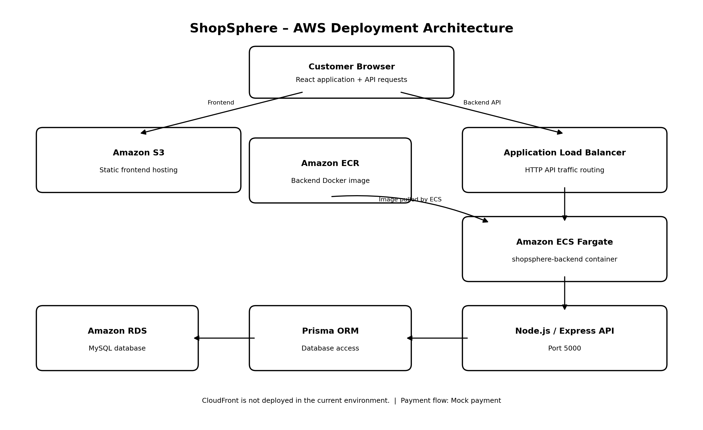
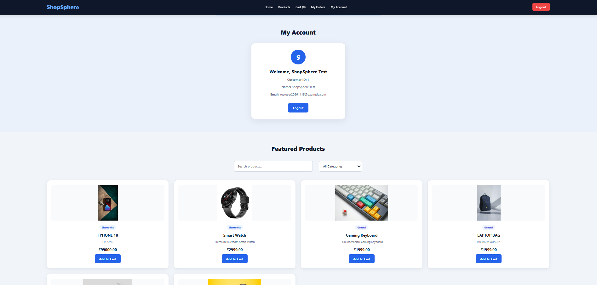
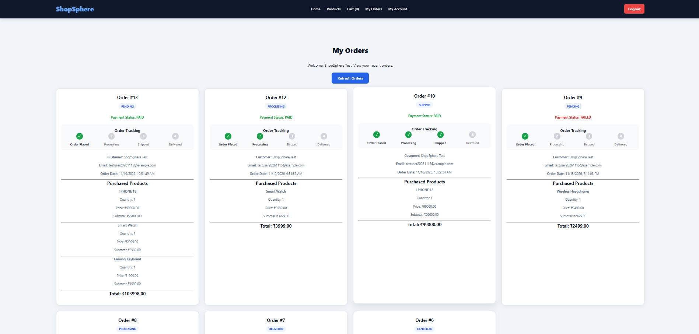
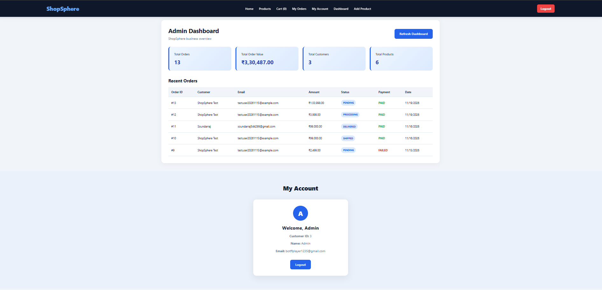
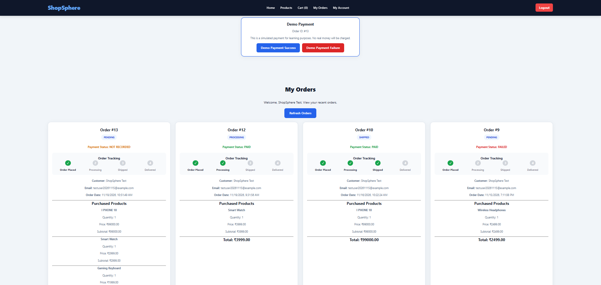
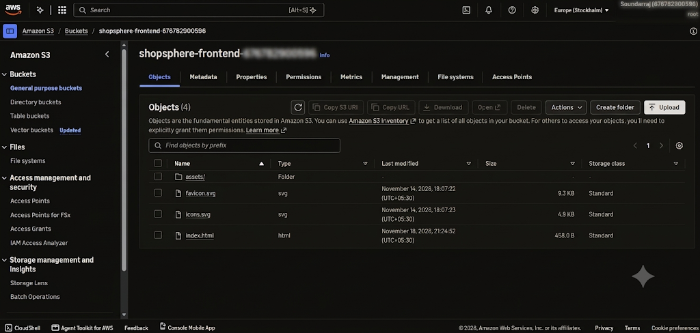
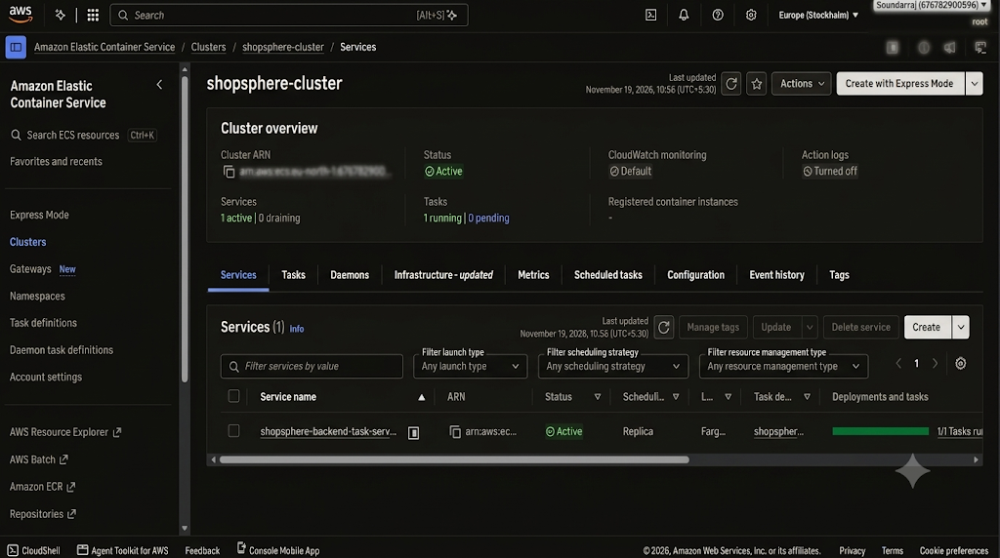
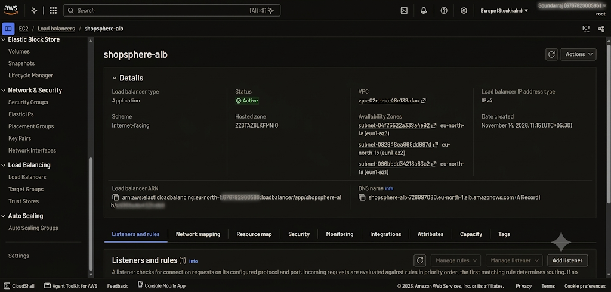
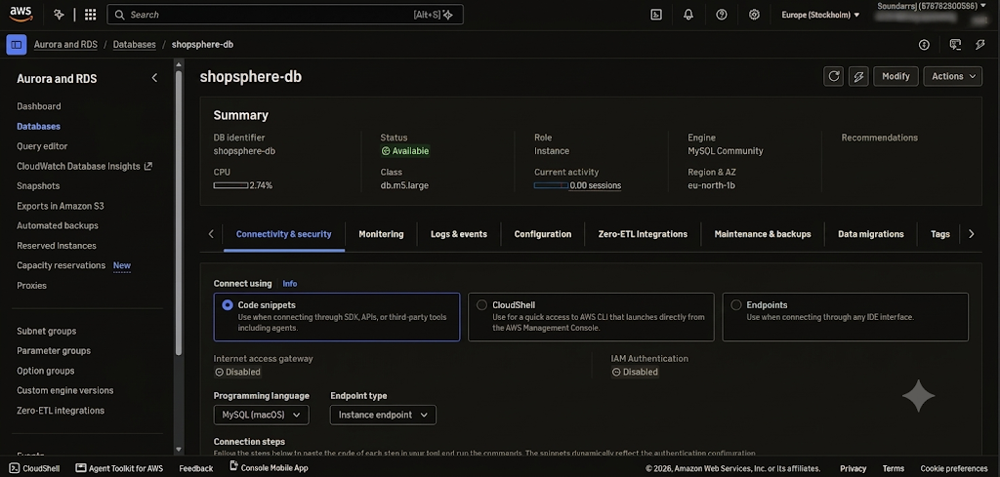

# ShopSphere – AWS Full-Stack E-Commerce Application

## Project Overview

ShopSphere is a full-stack e-commerce application built using React, TypeScript, Node.js, Express.js, Prisma ORM, and MySQL.

The application provides customer shopping features and administrative product and order management. Its frontend and backend are deployed using AWS services.

This project demonstrates practical cloud deployment, containerization, database integration, and full-stack application development.

## Technology Stack

### Frontend
- React 19
- TypeScript
- Vite
- HTML5
- CSS3

### Backend
- Node.js
- Express.js
- Prisma ORM
- JWT Authentication
- bcryptjs

### Database
- Amazon RDS
- MySQL
- Prisma ORM

### AWS Services
- Amazon S3 – Frontend static website hosting
- Amazon ECS Fargate – Backend container deployment
- Amazon ECR – Docker image repository
- Amazon RDS – Database hosting
- Application Load Balancer – Backend API traffic routing
- AWS IAM – Access and permissions management

### Containerization
- Docker
- Amazon ECR

## Application Features

### Customer Features
- Customer Registration and Login
- Product Listing
- Shopping Cart
- Checkout
- Mock Payment Processing
- Order History

### Admin Features
- Admin Authentication
- Admin Dashboard
- Product Management
- Order Management

## AWS Architecture




```text
                   Customer Browser
                          |
              +-----------+-----------+
              |                       |
              v                       v
       Amazon S3                 Application
     React Frontend             Load Balancer
                                      |
                                      v
                                Amazon ECS
                                  Fargate
                                      |
                                      v
                              Node.js / Express
                                      |
                                      v
                                  Prisma ORM
                                      |
                                      v
                                Amazon RDS
                                   MySQL

                   Amazon ECR
                       |
              Stores Backend Docker Images
                       |
                 Pulled by ECS
```

The frontend is hosted on Amazon S3. The browser communicates with the backend API through the Application Load Balancer.

Amazon ECR stores the backend Docker image, which is deployed to Amazon ECS Fargate.

Amazon RDS provides persistent MySQL database storage.

## Application Screenshots

### Customer Homepage



### Customer Orders



### Admin Dashboard



### Mock Payment



## AWS Infrastructure Screenshots

### Amazon S3 Frontend Hosting



### Amazon ECS Cluster



### Application Load Balancer



### Amazon RDS Database



## Backend Health Check

The backend provides a health-check endpoint:

```text
GET /health
```

Example successful response:

```json
{
  "status": "Healthy",
  "application": "ShopSphere Backend"
}
```

The endpoint was tested through the Application Load Balancer.

## Project Deployment

1. Develop the frontend using React and TypeScript.
2. Develop the backend using Node.js and Express.js.
3. Build the backend Docker image.
4. Push the image to Amazon ECR.
5. Deploy the backend using Amazon ECS Fargate.
6. Configure the Application Load Balancer to route API requests.
7. Configure Amazon RDS for MySQL database storage.
8. Host the frontend using Amazon S3 Static Website Hosting.
9. Test the application and backend health endpoint.

## Security Considerations

- Environment files are excluded from Git.
- Database credentials are not committed to the repository.
- AWS credentials and sensitive configuration files are excluded.
- Authentication uses JWT.
- Passwords are hashed using bcryptjs.
- Database credentials are stored using AWS Secrets Manager.

## Project Status

The ShopSphere application has been developed and deployed for learning and demonstration purposes.

- Frontend: Hosted on Amazon S3.
- Backend: Deployed using Amazon ECS Fargate.
- Database: Amazon RDS MySQL.
- API Routing: Application Load Balancer.
- Payment: Mock payment flow.
- CloudFront HTTPS distribution: Not yet deployed.

## Repository Structure

```text
ShopSphere-AWS-Ecommerce/
|
|-- backend/
|   |-- prisma/
|   |-- src/
|   |-- Dockerfile
|   |-- package.json
|
|-- frontend/
|   |-- public/
|   |-- src/
|   |-- package.json
|
|-- cloudformation/
|
|-- docs/
|   |-- images/
|       |-- customer-home.png
|       |-- customer-orders.png
|       |-- admin-dashboard.png
|       |-- demo-payment.png
|       |-- ecs-cluster.png
|       |-- load-balancer.png
|       |-- rds-database.png
|       |-- s3-bucket.png
|
|-- .gitignore
|-- README.md
```

## Project Purpose

This project demonstrates practical experience with:

- Full-Stack Application Development
- REST API Development
- Docker Containerization
- Amazon ECS and ECR
- AWS Cloud Infrastructure
- Amazon RDS Database Integration
- Application Load Balancing
- Authentication and Security
- Static Website Hosting

---

**Project:** ShopSphere – AWS E-Commerce Application

**Repository:** ShopSphere-AWS-Ecommerce
